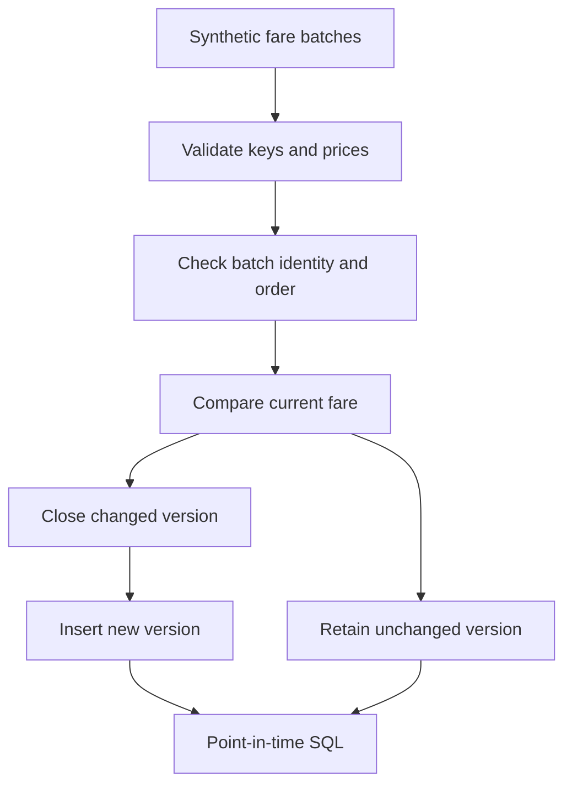

# Fare History Warehouse

A Python and SQL portfolio project that maintains airline fare history with Slowly Changing Dimension Type 2. It includes transactional updates, replay protection, half-open validity intervals, and point-in-time queries using synthetic travel data.

## Run in one minute

Requires Python 3.10+. No third-party packages or cloud account needed.

```bash
python pipeline.py
python pipeline.py --as-of 2026-01-01T12:00:00Z
python -m unittest -v
```

Run commands from the repository root. The first command creates `fares.db`. The second replays the same batches safely and queries the earlier state. Use `--database another.db` to build a separate database.

## How it works



Natural key: `(route, airline)`. Tracked attributes: fare in integer cents and currency. Changed fares close the current version and insert a new one inside one SQLite transaction. A partial unique index prevents multiple current versions per key. `valid_from` is inclusive; `valid_to` is exclusive. All timestamps normalize to UTC.

Batch IDs and content hashes protect against retries. Exact replays are skipped. Reusing a batch ID with changed content is rejected. New batches must be strictly later than the last accepted batch. Duplicate keys, invalid currencies, negative prices, and timestamps without timezones are rejected before changes.

## Sample result

Three batches create five historical versions and three current fares. DL ATL-JFK changes from 25000 to 23000 cents at the January 2 boundary. AA ATL-JFK changes from 24000 to 22000 cents on January 3. UA SFO-LAX stays at 18000 cents when absent from later batches.

`queries.sql` includes current fares, historical price changes with `LAG`, and an as-of query. Four tests cover exact boundaries, replays, conflicting payloads, out-of-order batches, duplicate keys, invalid prices, and timezone validation.

## Scope and tradeoffs

Batches are incremental upserts. An absent key is retained, not deleted. Late corrections require a deliberate rebuild and are rejected by the loader. This project runs locally with SQLite; it does not claim deployed Snowflake/dbt or GCP integration. Concurrent multi-writer ingestion, orchestration, deletion events, and production-scale benchmarks are future extensions.

## Interview walkthrough

Explain SCD Type 1 versus Type 2, show the exact-boundary query, replay the input, then demonstrate that changed batch content fails without updating history. Discuss how the same keys and validity model translate into a warehouse MERGE strategy.

## Provenance

A new AI-assisted portfolio implementation for Bhavuk Jain. All fares are synthetic. No employer code, private datasets, or claimed production results are included.
